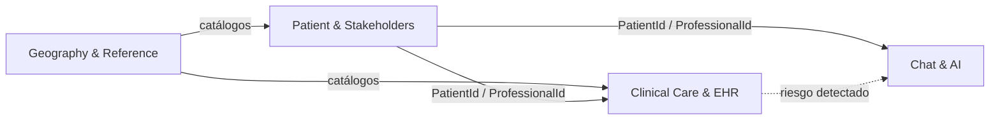

# Plataforma de Salud Mental & Teleorientación Asistida por IA

Arquitectura Hexagonal + Domain-Driven Design (DDD) modular sobre **Spring Boot 3 / Java 17 / PostgreSQL**.

Este proyecto parte de un modelo relacional de 52 tablas y lo reorganiza en **4 Bounded Contexts**, cada uno con su propio lenguaje, su propio código y sus propias reglas, implementados con arquitectura hexagonal.

---

## 1. Qué hice en este proyecto

1. **Analicé el modelo relacional y lo dividí por dominios de negocio.** En lugar de tratar las 52 tablas como un solo bloque, identifiqué qué tablas cambian juntas, quién las usa y qué concepto de negocio representan. De ahí salieron 4 Bounded Contexts.
2. **Creé un paquete independiente por contexto** en cada capa (`domain`, `application`, `infrastructure`): `geography`, `patient`, `clinical` y `chat`. Cada contexto tiene su propio modelo, casos de uso, controladores y persistencia.
3. **Apliqué arquitectura hexagonal.** El dominio no depende de Spring ni de JPA. Se comunica con el exterior solo mediante puertos (`RepositoryPort`, casos de uso), y la infraestructura los implementa con adaptadores.
4. **Modelé cada concepto con DDD táctico.** Cada entidad tiene un agregado raíz, Value Objects (`Id`, `Name`, `Status`), eventos de dominio y excepciones propias.
5. **Estandaricé cada entidad con el mismo patrón de 21 clases**, con 9 en dominio, 6 en aplicación y 6 en infraestructura. Así los 4 contextos tienen la misma estructura y son fáciles de navegar.
6. **Definí las relaciones entre contextos con referencias por ID.** Por ejemplo, `clinical` apunta a un paciente mediante `PatientId`, sin importar sus clases internas. Así los contextos se pueden evolucionar por separado.
7. **Escribí las migraciones Flyway (V1–V4), una por contexto**, que crean las tablas, llaves foráneas e índices.
8. **Verifiqué que todo compila** con `mvn compile -DskipTests` en los 5 módulos Maven.

---

## 2. Mapa de Bounded Contexts

| Bounded Context | Paquete | Responsabilidad | Migración |
| :--- | :--- | :--- | :--- |
| **Geography & Reference** | `com.demodd.*.geography` | Catálogos compartidos: territorio, documentos de identidad, géneros, parentescos y especialidades. | `V1` |
| **Patient & Stakeholders** | `com.demodd.*.patient` | Quién es quién: pacientes, contactos de apoyo, profesionales y sus credenciales. | `V2` |
| **Clinical Care & EHR** | `com.demodd.*.clinical` | La atención clínica: historia, sesiones, notas SOAP, examen mental, riesgo suicida y planes de tratamiento. | `V3` |
| **Chat & Artificial Intelligence** | `com.demodd.*.chat` | Conversación con el asistente IA, auditoría de inferencias, costes y escalamiento a un terapeuta humano. | `V4` |
| **IAM & Security** | `com.demodd.*.iam` / `com.demodd.infrastructure.security` | Autenticación, usuarios, roles (Admin, Profesional, Paciente, User) y seguridad sin estado con Spring Security 6 y JWT. | `V5` |

Entre los 5 contextos suman 53 entidades organizadas bajo arquitectura hexagonal.

### Cómo se relacionan



- **Geography & Reference** es un contexto de soporte: provee datos de referencia y no depende de ningún otro.
- **Patient & Stakeholders** es el núcleo de identidad. Clínica y Chat lo referencian solo por ID.
- **Clinical Care** y **Chat & AI** son los contextos principales del negocio, y cada uno evoluciona de forma independiente.

---

## 3. Los Bounded Contexts en detalle

### 3.1 Geography & Reference
**Qué resuelve:** datos maestros reutilizables por todo el sistema.
**Qué hice:** agrupé aquí todo lo que es catálogo estable y sin lógica clínica, para que los demás contextos no repitan estas tablas.
**Conceptos:** Country, StateRegion, CityMunicipality, DocumentType, Gender, RelationshipType, ProfessionalType, Study.

### 3.2 Patient & Stakeholders
**Qué resuelve:** el directorio de personas que participan en la atención.
**Qué hice:** separé a las personas (pacientes, contactos, profesionales) de lo que ocurre en la atención. Esto permite que el expediente clínico cambie sin tocar los datos de identidad.
**Conceptos:** Patient, PatientContact, PatientAllergy, Contact, PhoneContact, EmailContact, Professional, ProfessionalStudy.

### 3.3 Clinical Care & EHR
**Qué resuelve:** el registro clínico completo del paciente.
**Qué hice:** aislé el expediente en su propio contexto. Los catálogos clínicos (estados, tipos de encuentro, niveles de riesgo, etc.) viven junto a los agregados que los usan, y no en Geography.
**Conceptos principales:** ClinicalRecord, Encounter, ClinicalNote (SOAP), MentalStatusExam, RiskAssessment, TreatmentPlan, TreatmentGoal, más 11 catálogos clínicos.

### 3.4 Chat & Artificial Intelligence
**Qué resuelve:** la conversación asistida por IA y su trazabilidad.
**Qué hice:** dividí el contexto en subáreas coherentes:
- **Canal conversacional:** ChatConversation, ChatParticipant, ChatMessage, ChatConversationAiSetting.
- **Proveedores y modelos:** ProviderModelAi, AiModel.
- **Telemetría de IA:** ChatAiRun, ChatAiRunMetric, ChatAiRunError (tokens, costes y fallos).
- **Escalamiento a humano:** ChatEscalation, ChatEscalationStatusHistory, ChatEscalationAssignment.
- **Catálogos:** Priority, ConversationStatus, SenderType, MessageType, AiRunStatus, EscalationStatus.

### 3.5 Identity & Access Management (IAM) & Security
**Qué resuelve:** autenticación y control de acceso seguro y sin estado (*stateless*).
**Qué hice:**
- **Dominio IAM:** entidad `User`, Value Objects (`UserId`, `Username`, `UserEmail`, `PasswordHash`, `UserRole`, `UserStatus`), eventos y puertos de persistencia y codificación de contraseñas.
- **Aplicación IAM:** casos de uso para registro, login y consulta de usuarios (`RegisterUserUseCase`, `LoginUseCase`, etc.).
- **Infraestructura de Seguridad:** integración de **Spring Security 6** con filtro `JwtAuthenticationFilter`, `JwtService` (HMAC-SHA256 con JJWT 0.12.5), `BCryptPasswordEncoderAdapter`, `CustomUserDetailsService` y manejadores JSON para 401 y 403.
- **Endpoints públicos:** `POST /api/v1/auth/register`, `POST /api/v1/auth/login`.
- **Endpoints protegidos:** `GET /api/v1/auth/me` y todas las APIs de los demás contextos (`/api/v1/**`) requieren `Authorization: Bearer <token>`.

---

## 4. Estructura multimódulo (hexagonal)

```
tablas 2 - copia/
├── domain/                  # Núcleo de negocio, sin frameworks
│   └── <contexto>/model, event, exception, port/repository
├── application/             # Casos de uso
│   └── <contexto>/port/in, service, dto
├── infrastructure/          # Adaptadores
│   └── <contexto>/adapter/in/web, adapter/out/persistence
└── demo/                    # Módulo ejecutable (Spring Boot)
```

La regla de dependencia es `infrastructure → application → domain`, y nunca al revés.

### Patrón de 21 clases por entidad

| Capa | Clases |
| :--- | :--- |
| **Domain (9)** | Aggregate, `Id`, `Name`, `Status`, `CreatedEvent`, `UpdatedEvent`, `NotFoundException`, `AlreadyExistsException`, `RepositoryPort` |
| **Application (6)** | `Create/Update/Get/Delete UseCase`, `ApplicationService`, `Response` |
| **Infrastructure (6)** | `RestController` (`/api/v1/{entities}`), `Create/Update WebRequest`, `JpaEntity`, `SpringDataJpaRepository`, `RepositoryAdapter` |

---

## 5. Compilación y ejecución

```bash
mvn compile -DskipTests
```

Resultado verificado: `BUILD SUCCESS` en `demodd-parent`, `domain`, `application`, `infrastructure` y `demo`.

1. Crear la base de datos:
   ```sql
   CREATE DATABASE mental_health_db;
   ```
2. Iniciar la aplicación:
   ```bash
   mvn spring-boot:run -pl demo
   ```
   Flyway aplica las migraciones V1 a V5, creando las 53 tablas del sistema (incluyendo users).
